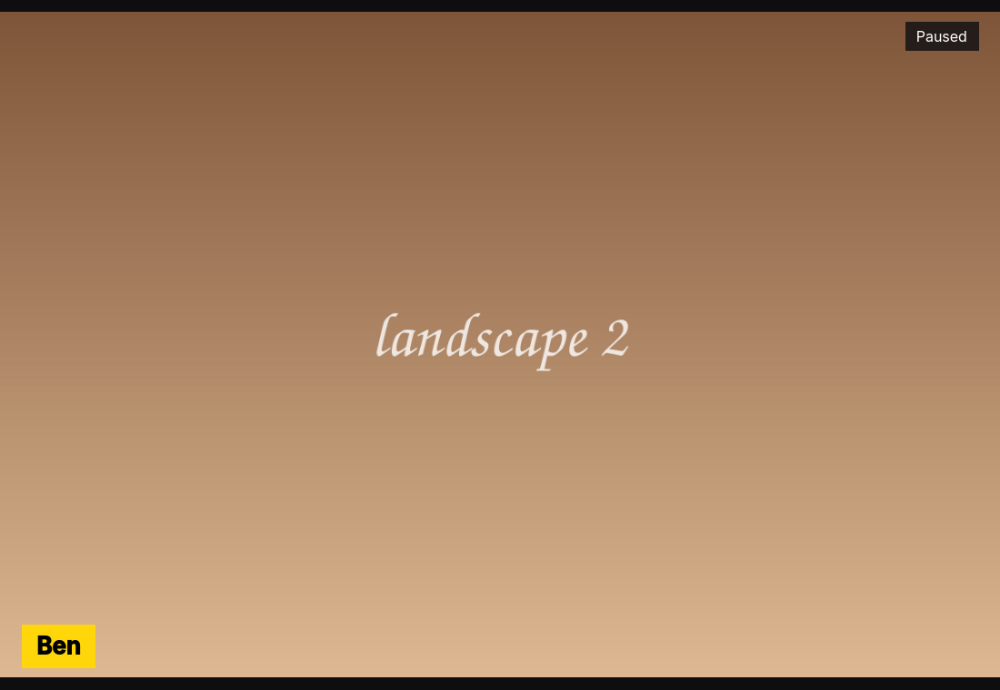

# Turns



A photo slideshow where the people in a folder take turns. Point it at one
folder of photos named with a name, a dash, and a number, like `Ada-12.jpg`
and `Ben-3.jpg`, and it shuffles between them.

- **Nobody appears twice in a row.** The people take turns in a shuffled order,
  and each gets one photo per round.
- **Every photo shows before any repeats.** Each person has their own shuffled
  queue, so someone with fewer photos comes around again sooner, and everyone
  still gets equal screen time.
- **Any number of people.** The name is everything before the first dash, so
  `Ada-1.jpg` and `ada-2.png` are both Ada, and `Anne-Marie-3.jpg` is Anne.
  A file with no dash has no name and is skipped, and the window says so.

Photos added to or removed from the folder are picked up while it plays, and
your files are never changed.

## Install

For Omarchy or Arch Linux on x86_64. Download the package from the
[latest release](https://github.com/midnightslicer/turns/releases/latest) and
install it:

```sh
curl -LO https://github.com/midnightslicer/turns/releases/download/v0.1.0/turns-0.1.0-1-x86_64.pkg.tar.zst
sudo pacman -U ./turns-0.1.0-1-x86_64.pkg.tar.zst
```

Or build the latest code yourself, which also works on aarch64:

```sh
git clone https://github.com/midnightslicer/turns.git
cd turns
bin/install
```

Run `git pull` and `bin/install` again to update. Either way, Turns then appears
in the app launcher (`Super + Space`). You can also run
`turns ~/Pictures/family`. Without a folder, it reopens the last one.

Photos can be JPEG, PNG, WebP, GIF, BMP, or TIFF. Install `kimageformats` to add
HEIC, AVIF, and JPEG XL. Anything it has to skip is reported in the window.

## Shortcuts

| Key | Action |
| --- | --- |
| `Space` | Pause or play |
| `→` | Next photo |
| `←` | Previous photo |
| `+` / `-` | Slower or faster (1 to 60 seconds per photo) |
| `T` | Fade on or off |
| `N` | Hide or show the name |
| `F` / `F11` | Full screen |
| `Esc` | Leave full screen |
| `O` | Open a folder |
| `?` | Show shortcuts |
| `Q` | Quit |

## Develop

```sh
bin/build   # build/turns
bin/test    # Qt Test, offscreen
```

MIT license.
